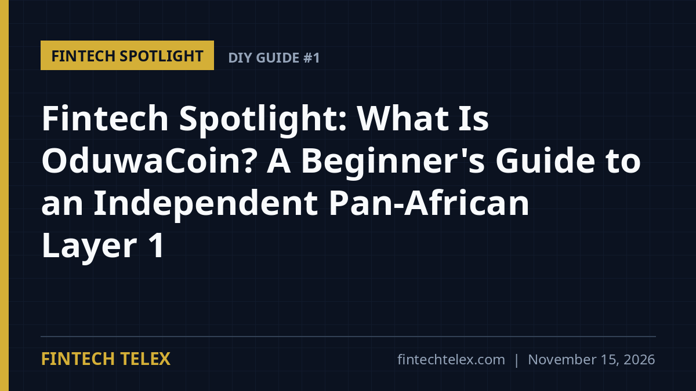

# Fintech Spotlight: What Is OduwaCoin? A Beginner's Guide to an Independent Pan-African Layer 1

Preview of DIY Guide #1, scheduled for Sunday, November 15, 2026 at 6:00 AM Pacific in the Fintech Spotlight category on fintechtelex.com.

| Field | Value |
|---|---|
| Byline | Staff Writer |
| Category | Fintech Spotlight |
| Web address | fintechtelex.com/fintech-spotlight-what-is-oduwacoin-beginners-guide/ |
| Google title | What Is OduwaCoin (OWC)? Beginner's Guide to Its Layer 1 \| Fintech Telex |
| Google description | What is OduwaCoin? Learn how OWC's independent Pan-African Layer 1 blockchain works, how proof-of-stake makes blocks, and which wallets and tools to use. |
| Focus keywords | what is OduwaCoin, OduwaCoin, OWC, Pan-African blockchain, independent Layer 1 blockchain |
| Tags | Fintech Spotlight, OduwaCoin, OWC, DIY Crypto Guide, Blockchain Tutorial, Layer 1 Blockchain, Proof of Stake, African Blockchain, Pan-African Crypto, OduwaPay, Oduwa Staking Pool, ETINOSA, Crypto for Beginners |
| Excerpt | New to OduwaCoin? This first Fintech Spotlight guide explains what OWC is, how its independent Layer 1 blockchain works, and the wallets, staking and explorer tools you'll use next. |

---

Most people meet crypto through tokens that live on someone else's network. OduwaCoin is different. It runs on its own blockchain, built with African users in mind, and anyone can download the software, check the code and take part. This first Fintech Spotlight guide explains, in plain language, what OduwaCoin is, how the network works and which tools you will use in the guides that follow.

## What you need

- About 10 minutes to read
- No crypto experience
- Optional: a computer or phone if you want to look at the live network as you read

## Step 1: Understand what "independent Layer 1" means

A Layer 1 is a base blockchain with its own nodes, its own rules and its own native coin. <a href="https://oduwacoin.io" target="_blank" rel="noopener">OduwaCoin's official website</a> describes it as "a Pan-African independent Layer-1 blockchain" and stresses that OWC is "not an ERC-20" and "not a BEP-20". In other words, OWC is not a token riding on Ethereum or BNB Chain. It is the native currency of the Oduwa Blockchain, the same way BTC is native to Bitcoin.

Why it matters: an independent chain does not depend on another network's fees, upgrades or outages. The trade-off is that its security depends on its own community of nodes and stakers, which is why later guides show you how to run a wallet and stake.

## Step 2: Know the coin and the code

- **Ticker:** OWC
- **Software:** OduwaCoin Core, the reference wallet and node, is open source under the MIT licence on <a href="https://github.com/ODUWAX/oduwacoin" target="_blank" rel="noopener">GitHub</a>. The public repository dates back to September 2018.
- **Latest release:** <a href="https://github.com/ODUWAX/oduwacoin/releases/tag/v2.0.0.3" target="_blank" rel="noopener">ETINOSA v2.0.0.3</a>, published on November 2, 2026, for Windows 64-bit, macOS (Apple Silicon and Intel), Linux desktop and Ubuntu server. Every download comes with SHA-256 checksums so you can confirm the file is genuine.

Open source means anyone can read exactly how the network works. You do not have to take anyone's word for it.

## Step 3: Learn how blocks are made

The project describes OduwaCoin as a hybrid proof-of-work and proof-of-stake (PoW/PoS) blockchain. The network's code shows how that played out: proof-of-work mining was used only for the first 5,000 blocks to launch the chain. After that, new blocks are created by proof-of-stake.

With proof-of-stake, there are no power-hungry mining rigs. Instead, people who hold OWC in a running wallet help confirm transactions and can earn staking rewards for doing so. Two rules from the code are worth remembering:

- Coins must sit in your wallet for at least 8 hours before they can start staking.
- Newly created staking rewards need 20 more blocks before you can spend them.

As of the latest verified network snapshot on November 11, 2026, the chain had passed 2.5 million blocks, according to the <a href="https://github.com/ODUWAX/oduwacoin/releases/tag/bootstrap" target="_blank" rel="noopener">official bootstrap release page</a>.

## Step 4: Meet the tools you will use

- **OduwaCoin Core wallet:** desktop software that gives you full self-custody and lets you stake on your own computer (ETINOSA solo staking).
- **<a href="https://www.oduwapay.com" target="_blank" rel="noopener">OduwaPay</a>:** the official wallet and payment app for holding, sending and receiving OWC.
- **<a href="https://www.oduwastakingpool.com" target="_blank" rel="noopener">Oduwa Staking Pool</a>:** a hosted service for people who want to stake without keeping a computer running.
- **<a href="https://chainz.cryptoid.info/owc/" target="_blank" rel="noopener">CryptoID explorer</a>:** a public website for looking up blocks, transactions and addresses.
- **<a href="https://oduwacoin.io/gift" target="_blank" rel="noopener">OduwaCoin gift page</a>:** where you can buy OWC with USDT and create gift cards.

## Step 5: See the network for yourself

1.  Open the <a href="https://chainz.cryptoid.info/owc/" target="_blank" rel="noopener">CryptoID OWC explorer</a>.
2.  Look at "Latest OWC Blocks" to see new blocks arriving.
3.  Click any block to see the transactions inside it.

That is the core idea of a public blockchain: every transaction is visible and can be checked by anyone.

## Safety tips before you start

- Download wallet software only from the <a href="https://github.com/ODUWAX/oduwacoin/releases" target="_blank" rel="noopener">official GitHub releases page</a> or links on oduwacoin.io.
- Never share your private keys, wallet.dat file or wallet password with anyone, including people claiming to be support staff.
- Be wary of direct messages offering to "double" your coins or fix your wallet. They are scams.

## Troubleshooting

**The explorer page shows "Loading...":** refresh after a few seconds. The figures load in the background.

**I can't find OWC on a token list in my Ethereum wallet:** that is expected. OWC is not an Ethereum token, so you need an OduwaCoin wallet such as OduwaCoin Core or OduwaPay.

## FAQ

**Is OduwaCoin a token on another blockchain?**  
No. OWC is the native coin of its own Layer 1 network.

**Do I need mining equipment?**  
No. Mining ended after the first 5,000 blocks. Today the network runs on proof-of-stake.

**What's the difference between solo staking and the staking pool?**  
Solo staking runs in your own OduwaCoin Core wallet, so you keep full control but the wallet must stay online. The pool is a hosted service that stakes for you. A later guide compares them side by side.

**What's next in this series?**  
Tomorrow: how to download OduwaCoin Core ETINOSA v2.0.0.3 safely and check its SHA-256 checksum.

*Risk note: Crypto assets are volatile. This guide is educational and not investment advice.*

*Disclosure: Fintech Telex and OduwaCoin share common ownership.*
